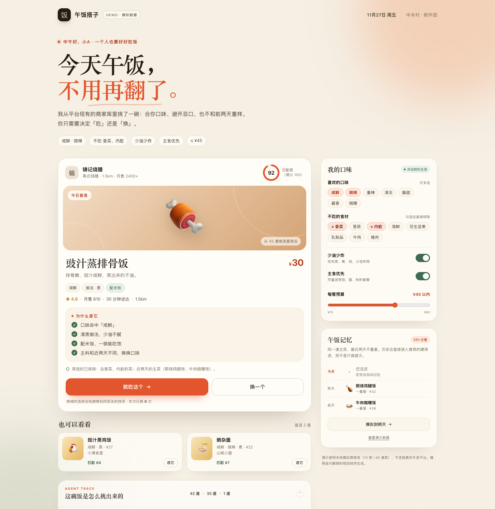

# 午饭搭子 · 今天午饭吃什么

一个可体验的午饭推荐 Agent Demo：依托外卖平台现有的商家数据库，帮一个人在办公室快速决定午饭。

**在线体验：** 部署完成后见仓库右侧 About 中的 Pages 链接（`https://augirt.github.io/lunch-buddy/`）。



---

## 1. 核心问题

来自用户小A的真实反馈：

> 一个人在办公室吃午饭，每天打开外卖软件都不知道点什么，翻来翻去很费时间。希望能按口味选、避开不吃的食材、连续两天别吃同一道主菜，也希望少油少炸、尽量有主食。

把它拆成四个具体问题：

| 问题 | 用户的真实感受 | Demo 里的对应设计 |
| --- | --- | --- |
| **选择过载** | 打开 App 先刷 20 分钟，最后随便点一个 | 每次只给 **1 个首选 + 2 个备选**，默认「就吃这个」 |
| **偏好记不住** | 口味、忌口每次都要自己想、自己筛 | 可编辑的偏好档案，忌口和预算变成**硬约束** |
| **重复疲劳** | 连着两天吃同一道菜，想起来就没胃口 | 午饭记忆：同一道主菜 **48 小时内不再推荐** |
| **健康与结构** | 想少油少炸、有主食，但菜单不这么标 | 少油少炸、主食优先变成可解释的**排序权重** |

核心洞察：用户不缺商家和菜品，缺的是一个**替他把选择做完、并且说得清为什么**的代理。

## 2. 方案思路

### 产品形态：先给答案，再给理由

不是再做一个「更聪明的搜索框」，而是把决策流程压缩成一次判断：

> 今天吃这个 → 不想吃就换 → 想看看别的也有备选。

打开即见答案，降低「翻菜单」的成本；「换一个」时才逐步展开更多候选。

### 推荐 Agent 的五层结构

1. **偏好档案（显式偏好）**
   口味多选、忌口多选、少油少炸、主食优先、每餐预算。改动即时生效并持久化。

2. **召回（平台现有商家库）**
   只从营业中的商家召回可售菜品。Demo 使用 10 家商家 / 44 道菜的模拟数据库（含 1 家休息中），对应真实产品里对商家库的查询。

3. **硬约束（不做妥协）**
   - 命中忌口食材 → 直接排除
   - 超过预算 → 直接排除
   - 近两天吃过同一道主菜 → 直接排除

4. **软排序（偏好加权）**
   在剩下的候选里按 100 分制打分：

   | 维度 | 权重 | 说明 |
   | --- | --- | --- |
   | 口味匹配 | 34 | 命中用户选择的咸鲜/微辣/清淡等 |
   | 健康少油 | 22 | 蒸煮炖优先，炸物与高油降权 |
   | 有主食 | 14 | 有米饭/面/粉等更适合正餐 |
   | 口碑销量 | 14 | 评分与月售 |
   | 送达时效 | 8 | 午休时间有限 |
   | 新鲜感 | 8 | 避开近两天同主料/同菜系；换掉的选择会轻微降权 |

5. **解释与记忆**
   每条推荐都展示：为什么是它、已排除什么、得分构成、备选是谁。点「就吃这个」后写入午饭记忆；「模拟到明天」可以立即验证第二天的去重规则。

### 关键产品决策

- **忌口、预算、重复是硬约束，油和主食是软偏好。** 用户说「尽量有主食」「希望少油」，不应该因为一顿饭没有主食就直接没得选；但「不吃香菜」必须绝对可靠。
- **去重记录到「主菜」而不是订单。** 用户记住的是「昨天吃了照烧鸡腿饭」，不是 SKU；48 小时和「同一道主菜」直接对应用户原话。
- **换掉也是反馈。** 连续换菜会降低同菜系/同主料的排序，但不写成永久黑名单，避免一次手滑把爱吃的店封杀。
- **透明比神秘更重要。** 匹配度、得分构成、排除项全部可见；用户不信任推荐时，可以自己检查规则。

### 技术实现与边界

- 纯前端静态站：`index.html + styles.css + data.js + app.js`，无构建、无依赖、无后端。
- 数据和偏好都存在 `localStorage`，可直接用 `file://` 打开，也可部署到 GitHub Pages。
- 当前推荐由**可解释的规则排序**完成，不调用大模型，方便评审每一步决策。
- 生产化可以保留这套约束层，把「偏好解析、推荐文案、多轮澄清」交给模型，并接入真实商家库与 CTR / 复购 / 评价等线上信号；冷启动阶段则用显式偏好 + 轻量反馈补齐。

## 3. 三分钟体验路径

1. 打开演示页，看到默认推荐：**豉汁蒸排骨饭 92 分**。
2. 点「换一个」：观察推荐变化和左下角的「已换 N 次」，同菜系会被轻微降权。
3. 在右侧「我的口味」勾选「海鲜」、调低预算：推荐即时重排，展开 `AGENT TRACE` 可以看到每一层筛掉了多少道。
4. 点「就吃这个」：写入午饭记忆，弹窗确认。
5. 点「模拟到明天」：昨天的菜进入回避名单，今天不会再推同一道主菜。
6. 点「重置演示数据」可随时恢复初始状态。

## 4. 本地运行

无需安装任何依赖：

```bash
# 方式一：直接打开
open index.html

# 方式二：起一个静态服务（推荐）
python3 -m http.server 8000
# 浏览器访问 http://localhost:8000
```

## 5. 文件结构

```
.
├── index.html      # 页面骨架
├── styles.css      # 视觉与响应式
├── data.js         # 模拟商家库、菜品、忌口与默认偏好
├── app.js          # 推荐规则、记忆状态、交互
├── assets/
│   └── preview.png # README 预览图
└── README.md
```

## 6. 已知边界

- 商家与菜品均为模拟数据，不连接真实外卖平台，也不产生真实下单。
- 偏好是显式设置的；尚未实现从长期订单历史中自动学习口味。
- 只模拟单用户、单设备；多用户、实时库存、配送范围、优惠券等均未覆盖。
- 规则排序在演示规模下足够，真实规模的召回与排序需要独立的检索/排序服务。
